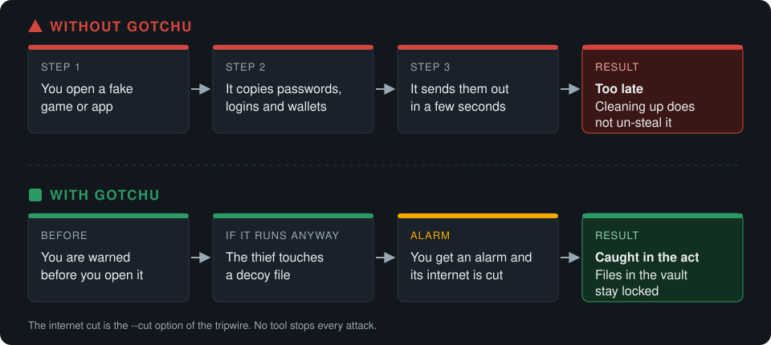

# GotchU

**Antivirus guards the door. GotchU guards the safe.**

Some malware does not break your PC. It runs once, copies your saved passwords, logins and wallets, and
leaves. Antivirus often misses it, and cleaning up afterwards does not un-steal anything.

GotchU is a free tool for Windows. It warns you before a bad click, catches the thief in the act, and
tells you what to do after.

Status: early. It works on the author's Windows 11 Home PC; it has not been tested widely.

## Install

You need Windows 10 or 11 and Python 3.10 or newer. Nothing else.

    pip install gotchu
    gotchu app

`gotchu app` opens GotchU in its own window. The first time, it explains itself in three lines and
offers one button, "Turn on protection", which can also add GotchU to the Start menu and the desktop.
After that you open it like any other app and never need a terminal again.

Home says in plain words whether you are protected, shows it on a dial (a padlock in a ring of three arcs,
one per protection, that clicks shut when all three are on), and lists your protection with a switch for each:
the theft alarm, cutting the thief off from the internet, the right-click check, and stricter Windows
settings. From the window you can also check a download, keep key files in the vault, see what to do
after a bad click, and see what a thief could take. "Check with GotchU" appears in File Explorer's right-click menu (on Windows 11
under "Show more options"). The window has a light and a dark look.

Everything can still be done from the command line.

**If Windows blocks the `gotchu` command.** With Smart App Control on, Windows may say "An Application
Control policy has blocked this file", because the command pip makes is not signed. Use
`python -m gotchu app` instead. It does the same thing, and the Start-menu shortcut is not affected.
A signed installer is planned.

## What it does

| Command | What it tells you or does |
|---|---|
| `gotchu check <file>` | Is this download safe to open? It reads the file without running it. |
| `gotchu harden` | Which Windows protections are off? It can turn them on, and `--undo` puts them back. |
| `gotchu exposure` | What could a thief take from this PC today? Counts only, it never shows a secret. |
| `gotchu tripwire` | Plants decoy files. When one is read you get an alarm, and `--cut` cuts that program's internet. |
| `gotchu vault` | Keeps key files encrypted with a passphrase, so a stolen copy is useless. |
| `gotchu scan` | Am I infected right now? |
| `gotchu respond` | I ran something bad. A checklist of what to do, in order. |
| `gotchu app` | Opens GotchU in its own window, with all of the above. `gotchu ui` opens the same window as a browser tab. |
| `gotchu setup` | Installs or removes the small helpers that need administrator rights. |
| `gotchu uninstall` | Puts back everything GotchU set up, before you remove it. Your vault is kept. |

Every command in detail: [docs/COMMANDS.md](https://github.com/AnshMittal08/GotchU/blob/main/docs/COMMANDS.md)

## Try it

    gotchu check Downloads\game.zip
    gotchu scan
    gotchu exposure
    gotchu tripwire --on
    gotchu vault create

## Remove GotchU

In the window: Protection, then "Remove GotchU" at the bottom. Or in a terminal:

    gotchu uninstall
    pip uninstall gotchu

The first line puts back everything GotchU set up (the decoys, the watcher, any internet block, the
Windows settings it changed, the right-click entry and the shortcuts) and shows each step first.
Windows asks for permission for the parts that need it. Your vault is kept, because it holds your
files. The second line removes the program. Removing only the program would leave the watcher running.

## Promises

- **Local.** Nothing leaves your PC. No account.
- **Read-only unless you say so.** A change needs your yes and a Windows permission prompt, and can be undone.
- **Plain language.** Every finding says what was seen, why it matters and what to do.

## Honest limits

- No tool stops every attack.
- The tripwire raises its alarm for decoys only. Reads of your real login stores are listed for review,
  not yet alarmed.
- A patient attacker with administrator rights can switch any tool off.
- The vault protects files at rest. A file you have taken out is an ordinary file again.
- If you lose both the vault passphrase and the recovery key, the files are gone.
- If GotchU sits in a folder your account can change (a cloned copy, or Python installed just for you),
  a program running as you could change GotchU too. `gotchu setup` tells you when that is the case.

## Learn more

- [How it works](https://github.com/AnshMittal08/GotchU/blob/main/docs/ARCHITECTURE.md): the parts, what
  runs with which rights, and how the tripwire, locks and vault work, as diagrams.
- [Who it is for](https://github.com/AnshMittal08/GotchU/blob/main/docs/USER_FLOWS.md): the journeys it
  is designed around.
- [Where it is going](https://github.com/AnshMittal08/GotchU/blob/main/ROADMAP.md): unlocking the vault
  with Windows Hello, an alarm for reads of real browser and chat stores, and a signed installer.
- [What changed](https://github.com/AnshMittal08/GotchU/blob/main/CHANGELOG.md) in each release.
- [Landing page](https://github.com/AnshMittal08/GotchU/blob/main/site/index.html): one file; download
  it and open it in a browser. Scrolling plays a theft twice in 3D, once unguarded and once with GotchU.

## Help out

Tests: `python -m unittest`. Every push is also linted and tested on Python 3.10 to 3.13 by GitHub Actions.

To help, see [CONTRIBUTING.md](https://github.com/AnshMittal08/GotchU/blob/main/CONTRIBUTING.md).
To report a weakness, see [SECURITY.md](https://github.com/AnshMittal08/GotchU/blob/main/SECURITY.md).

## Licence

Apache-2.0. See [LICENSE](https://github.com/AnshMittal08/GotchU/blob/main/LICENSE).
