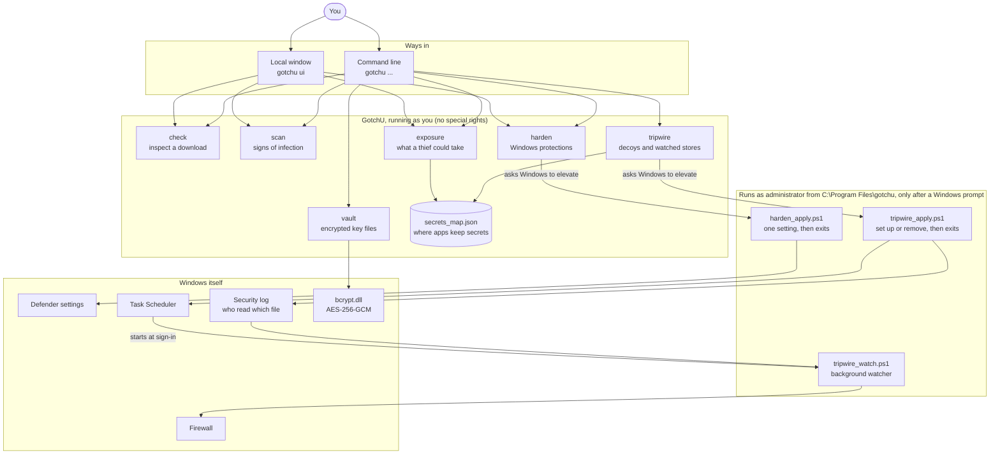
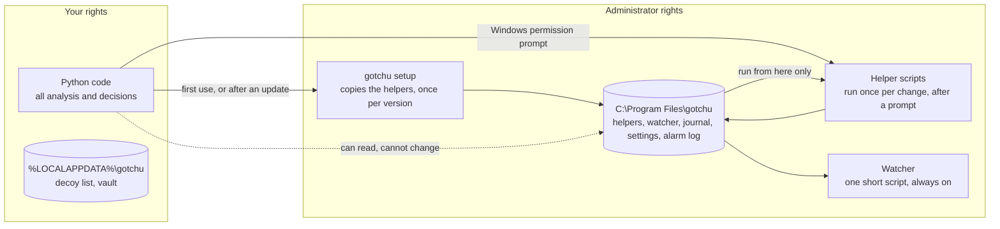
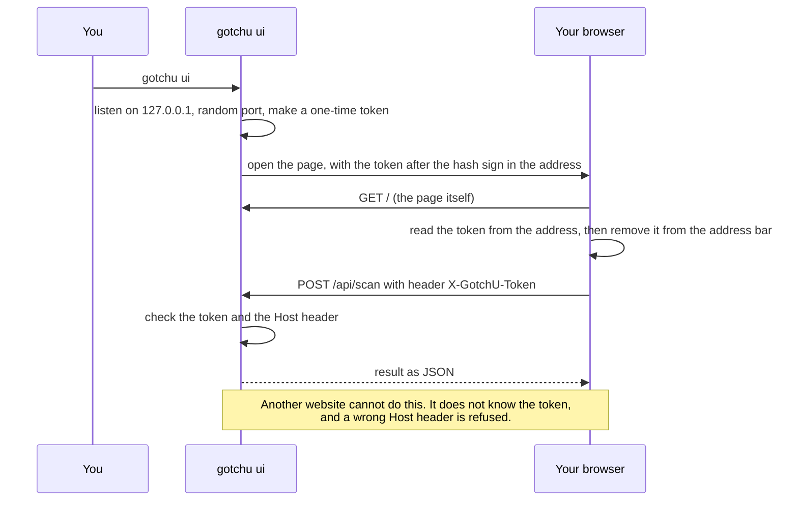
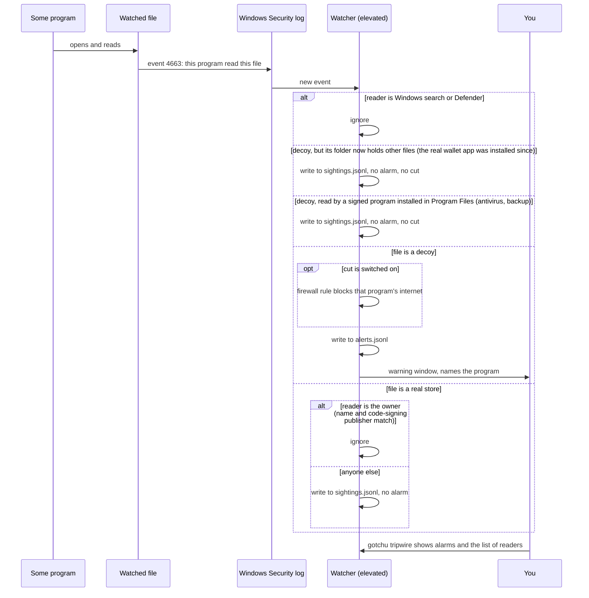
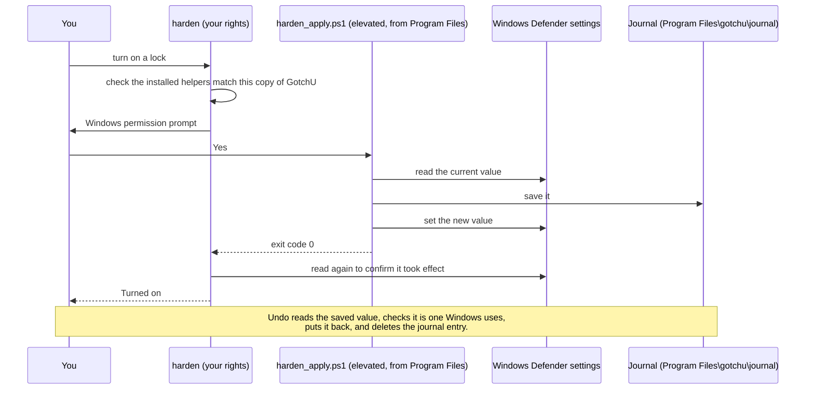
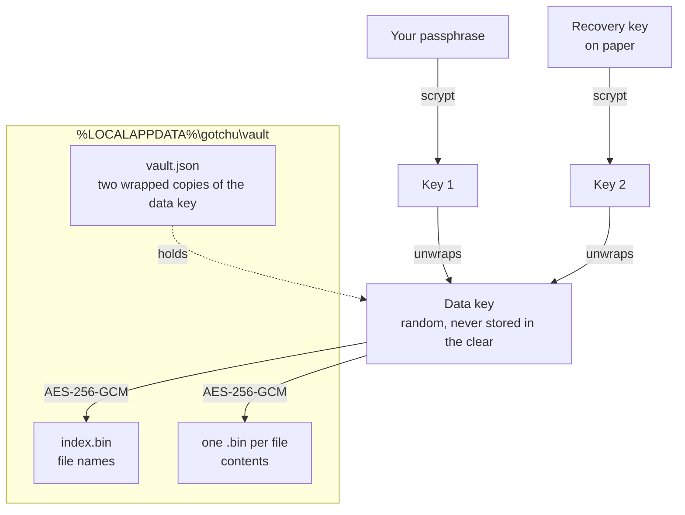
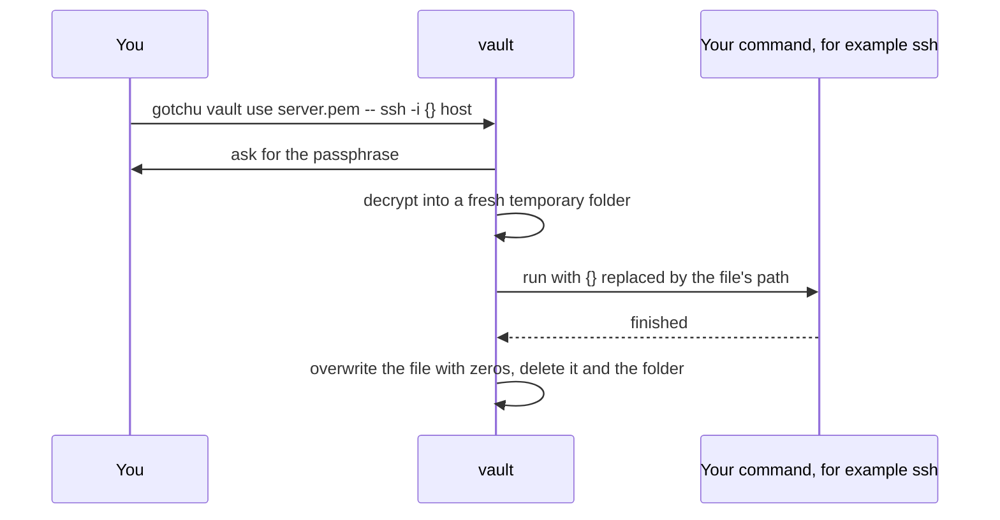

# How GotchU is built

Diagrams of the parts, who talks to whom, and what runs with which rights. They describe the code as it
is today; things that are planned but not built are marked. The diagrams render on GitHub.

## 1. The parts

The window covers check, scan, exposure and harden. The tripwire and the vault are command line only for now.

## 2. What runs with which rights

GotchU keeps the administrator part as small as it can, because that is the part an attacker would
most like to borrow.

- Everything in `C:\Program Files\gotchu` can be changed only by an administrator. So a program running
  as you cannot edit the scripts that run elevated, the journal undo reads, the list of decoys, or the
  alarm log.
- The helpers always run from there, never from GotchU's own folder. They are copied in the first time
  they are needed, or by `gotchu setup` after an update; a copy is kept only if it is exactly the file
  GotchU read (same SHA-256). After that, GotchU refuses to ask for elevation while its own copy differs
  from the installed one, and says why.
- Anything a helper reads from your profile is checked first: the tripwire's list of files must match a
  SHA-256 passed on the command line, and a journal from an older version may only hold values Windows
  uses for that setting.
- The watcher is PowerShell run by Windows' own `powershell.exe`. No Python and nothing from a
  user-writable folder runs elevated in the background.
- Helpers report through their exit code, and the alarm log lives in Program Files, so nothing elevated
  writes into a folder that an ordinary program could redirect.
- Limit: if GotchU's own folder is one you can change (a cloned copy, or Python installed only for you),
  a program running as you could change GotchU's Python code and with it what GotchU asks Windows to
  run. `gotchu setup` warns about this. Installing GotchU for all users, or the planned signed
  installer, closes it.

## 3. The local window

## 4. Tripwire: what happens when something reads a watched file

Decoys are fake wallet files planted only where the real wallet app is not installed. Real stores are
the browser, Telegram and Discord login files from the secrets map. Reads of real stores are listed, not
alarmed, until we know how often honest programs do it.

If a wallet app is installed later, it moves into the decoy's folder. GotchU records a SHA-256 of each
decoy when it plants it, and removing decoys (`--off`, or retiring one with `--on`) deletes only files
that still match, then the folders GotchU made if they are empty. It never deletes a folder's other
contents, so the app's real wallet is left alone.

## 5. Harden: changing a Windows protection, with undo

## 6. Vault: how the keys fit together

A thief who copies the vault folder gets the wrapped data key and the encrypted files, and can open
neither without the passphrase or the recovery key. Each file is tied to its own name inside the
vault, so swapping two encrypted files is detected, as is changing a single bit.

`vault use` is the way to use a key without leaving it lying around:

## 7. Where things are kept

| Place | What | Who can change it |
|---|---|---|
| `gotchu/secrets_map.json` (in the code) | Where apps keep secrets, their owners and publishers | Contributors |
| `%LOCALAPPDATA%\gotchu\decoys.json` | Which decoy files GotchU planted and a SHA-256 of each, so it removes only those | You |
| `%LOCALAPPDATA%\gotchu\vault` | The encrypted vault | You (useless without the passphrase) |
| `C:\Program Files\gotchu\harden_apply.ps1`, `tripwire_apply.ps1` | The helpers that make changes | Administrators only |
| `C:\Program Files\gotchu\tripwire_watch.ps1` | The watcher | Administrators only |
| `C:\Program Files\gotchu\journal` | Previous value of each lock GotchU turned on (earlier versions kept it in `%LOCALAPPDATA%\gotchu\journal`; it moves over on the next change) | Administrators only |
| `C:\Program Files\gotchu\last-error.txt` | Why the last change a helper tried did not work | Administrators only |
| `C:\Program Files\gotchu\tripwire.json` | Decoys, watched stores, cut on or off, the audit setting from before | Administrators only |
| `C:\Program Files\gotchu\alerts.jsonl`, `sightings.jsonl` | Alarms, and reads listed for review: other programs reading real stores, installed programs reading decoys | Administrators only |

Nothing is sent anywhere. GotchU makes no network connections.

## 8. Planned, not built

`respond` (what was readable at the time of a theft, and a recovery checklist), a background watch that
warns when a lock is switched off, a signed installer, and a driver that blocks reads outright where
today's tripwire can only report them. See [PRODUCT_PLAN.md](PRODUCT_PLAN.md).
