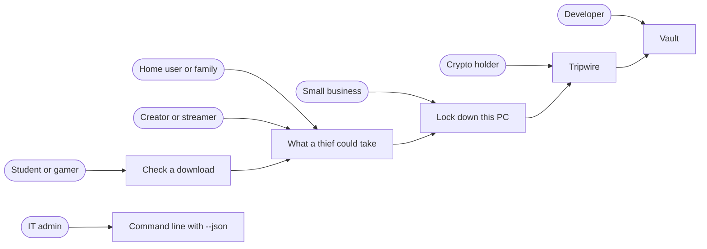
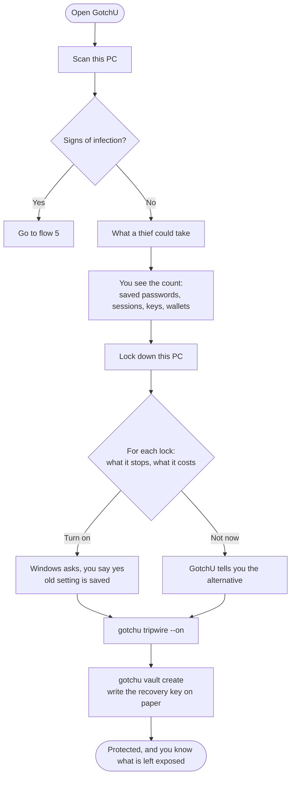
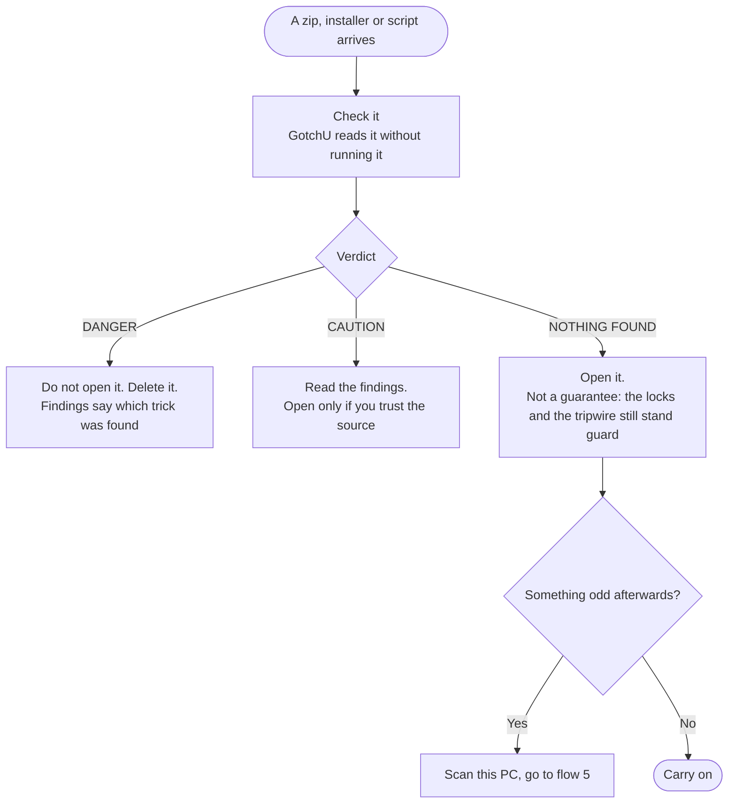
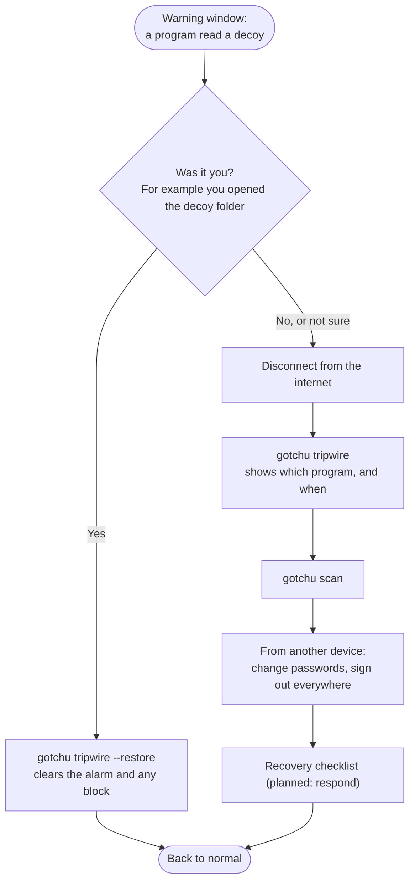
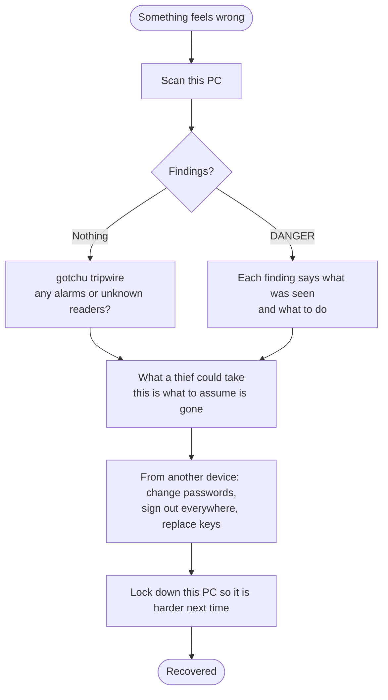
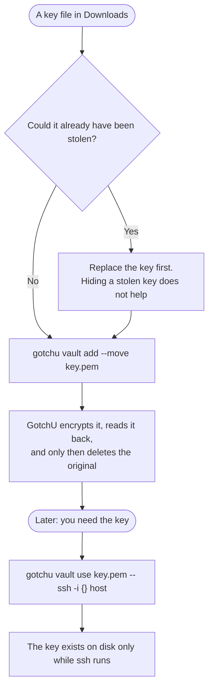

# How people use GotchU

The journeys GotchU is designed around. Steps that are not built yet are marked "planned". The diagrams
render on GitHub.

## 1. Who it is for, and where each person starts

Everyone ends up on the same path. The entry point is whichever question that person arrives with.

## 2. First ten minutes on a new PC

## 3. "I just downloaded something"

## 4. "The alarm went off"

With `--cut` switched on, the program that read the decoy has already lost its internet by the time the
window appears.

## 5. "I think I was infected"

A clean scan is not proof. The exposure report is the honest list of what an attacker could have taken.

## 6. Moving a key into the vault and using it

## 7. Changing your mind

Every change GotchU makes has a way back.

| You did | To undo |
|---|---|
| Turned on a lock | `gotchu harden --undo <lock>`, or "Put it back" in the window |
| Turned on the tripwire | `gotchu tripwire --off` removes the decoys, the watcher and the Windows setting |
| Got an alarm, dealt with it | `gotchu tripwire --restore` lifts the block and clears the alarm |
| Put a file in the vault | `gotchu vault get <name>` takes it out again |
